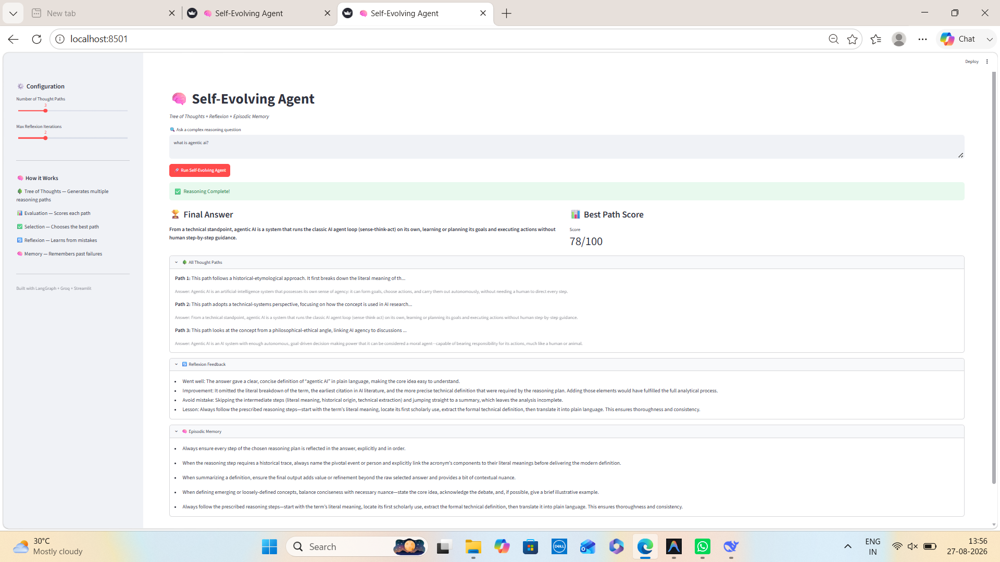
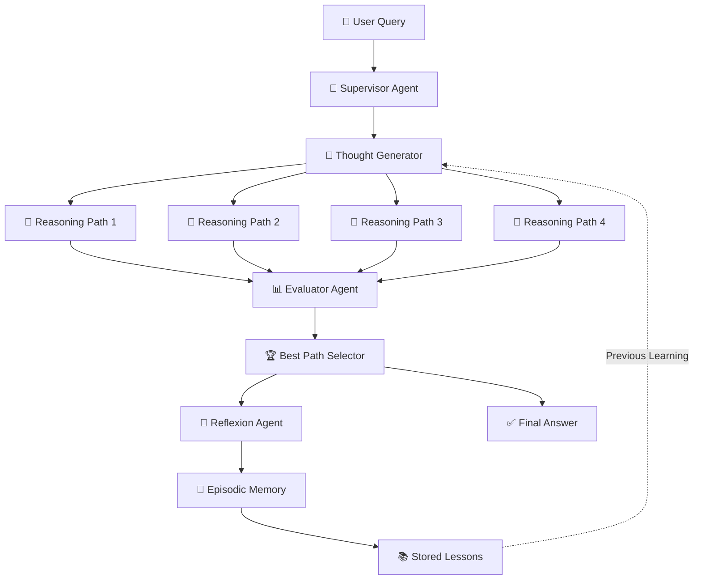
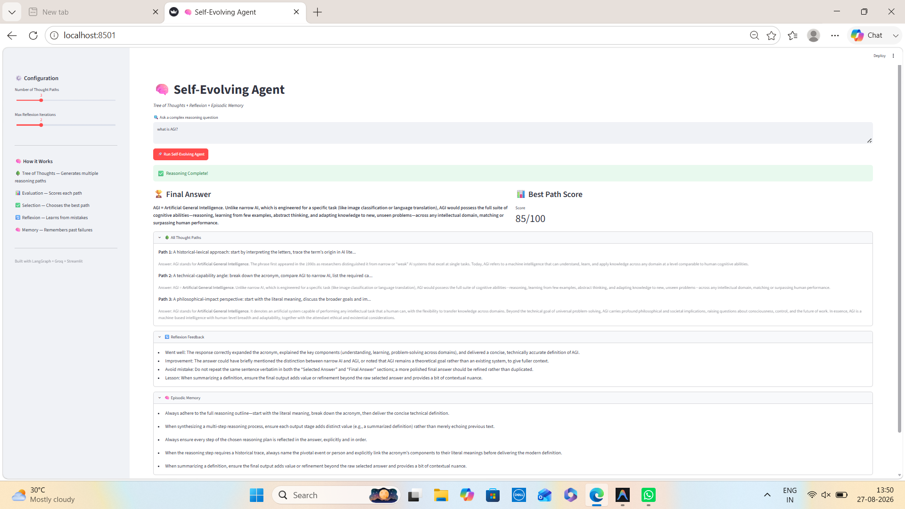

<p align="center">
  
  
  
  
  
</p>

<h1 align="center">🧠 Self-Evolving Agent</h1>

<h3 align="center">
Tree of Thoughts • Reflexion • Episodic Memory • Agentic AI
</h3>

<p align="center">
  <i>An AI agent that learns from reasoning attempts and uses past lessons to improve future responses.</i> 🚀
</p>

<p align="center">
  
</p>

---

## 🌟 Overview

**Self-Evolving Agent** is an experimental **Agentic AI system** designed to generate multiple reasoning approaches, evaluate their quality, select the strongest approach, reflect on the result, and store useful lessons for future interactions.

The project combines:

- 🌳 **Tree of Thoughts (ToT)**
- 📊 **LLM-based Path Evaluation**
- 🏆 **Best Path Selection**
- 🔄 **Reflexion**
- 🧠 **Episodic Memory**
- 🤖 **Supervisor-based Agent Orchestration**
- ⚡ **Groq LLM Inference**
- 🖥️ **Interactive Streamlit Dashboard**

The central idea is simple:

> **Generate → Evaluate → Select → Reflect → Remember → Improve**

---

# 🏗️ Architecture



---

# 🔄 Agent Workflow

```text
                    USER QUERY
                         │
                         ▼
               ┌───────────────────┐
               │  SUPERVISOR AGENT │
               └─────────┬─────────┘
                         │
                         ▼
               ┌───────────────────┐
               │ THOUGHT GENERATOR │
               └─────────┬─────────┘
                         │
          ┌──────────────┼──────────────┐
          ▼              ▼              ▼
       PATH 1         PATH 2         PATH 3
          │              │              │
          └──────────────┼──────────────┘
                         ▼
               ┌───────────────────┐
               │ EVALUATOR AGENT   │
               │                   │
               │ Relevance         │
               │ Coherence         │
               │ Completeness      │
               │ Accuracy          │
               └─────────┬─────────┘
                         ▼
               ┌───────────────────┐
               │ BEST PATH         │
               │ SELECTION         │
               └─────────┬─────────┘
                         ▼
               ┌───────────────────┐
               │ REFLEXION AGENT   │
               └─────────┬─────────┘
                         ▼
               ┌───────────────────┐
               │ EPISODIC MEMORY   │
               └─────────┬─────────┘
                         │
                         ▼
                    FINAL ANSWER
```

---

# ✨ Key Features

| Feature | Description |
|---|---|
| 🌳 **Tree of Thoughts** | Generates multiple candidate reasoning approaches for a query |
| 📊 **Path Evaluation** | Evaluates generated paths using quality criteria |
| 🎯 **Relevance Scoring** | Measures how well a path addresses the user's query |
| 🧩 **Coherence Scoring** | Checks whether reasoning is logically consistent |
| 📚 **Completeness Scoring** | Evaluates whether important aspects are covered |
| ✅ **Accuracy Evaluation** | Uses LLM-based evaluation to assess answer quality |
| 🏆 **Best Path Selection** | Selects the strongest reasoning path |
| 🔄 **Reflexion** | Analyzes what worked and what could be improved |
| 🧠 **Episodic Memory** | Stores lessons from previous reasoning attempts |
| ♻️ **Self-Improvement Loop** | Reuses stored lessons in future reasoning |
| 🤖 **Supervisor Agent** | Coordinates the complete agent workflow |
| 🖥️ **Streamlit Dashboard** | Provides an interactive interface |
| ⚡ **Groq LLM** | Enables fast LLM inference |

---

# 🧠 Core Concepts

## 🌳 1. Tree of Thoughts

Instead of relying on only one reasoning approach, the system generates multiple possible approaches.

```text
Question
   │
   ├── Path 1 → Direct Technical Explanation
   │
   ├── Path 2 → Step-by-Step Reasoning
   │
   ├── Path 3 → Example-Based Explanation
   │
   └── Path 4 → Alternative Perspective
```

Each path represents a different approach to solving the same problem.

---

## 📊 2. Path Evaluation

Every generated path is evaluated using multiple criteria:

```text
Final Score =
    Relevance
  + Coherence
  + Completeness
  + Accuracy
```

The evaluator helps identify which reasoning approach is strongest for the current query.

---

## 🏆 3. Best Path Selection

After evaluation:

```text
Path 1 → Score: 78
Path 2 → Score: 91  ⭐ Selected
Path 3 → Score: 84
Path 4 → Score: 76
```

The highest-quality candidate is selected as the best reasoning path.

---

## 🔄 4. Reflexion

The Reflexion component analyzes the selected result and asks questions such as:

- What worked well?
- What could be improved?
- Was important information missing?
- What mistake should be avoided next time?

Example:

```text
Strength:
The answer clearly explained the core concept.

Improvement:
Add a practical example for better understanding.

Lesson:
For conceptual questions, explain the definition first
and then provide a real-world example.
```

---

## 🧠 5. Episodic Memory

Lessons generated through Reflexion are stored in memory.

```text
Interaction 1
      │
      ▼
Reasoning Attempt
      │
      ▼
Reflexion
      │
      ▼
Lesson Stored
      │
      ▼
Episodic Memory
      │
      ▼
Future Queries
      │
      ▼
Better Reasoning Guidance
```

This allows the system to reuse previous feedback rather than treating every interaction completely independently.

---

# 📂 Project Structure

```text
self-evolving-agent/
│
├── src/
│   │
│   ├── agents/
│   │   ├── __init__.py
│   │   ├── supervisor.py
│   │   ├── thought_generator.py
│   │   ├── evaluator.py
│   │   ├── selector.py
│   │   └── reflexion.py
│   │
│   ├── memory/
│   │   ├── __init__.py
│   │   └── episodic_memory.py
│   │
│   ├── graph/
│   │   ├── __init__.py
│   │   └── workflow.py
│   │
│   ├── config/
│   │   ├── __init__.py
│   │   └── settings.py
│   │
│   └── app.py
│
├── images/
│   ├── dashboard.png
│   └── workflow.png
│
├── demo/
│   └── demo.mp4
│
├── requirements.txt
├── .env.example
├── .gitignore
└── README.md
```

> **Note:** The exact folder structure may vary depending on the current implementation of the project.

---

# 🛠️ Tech Stack

| Layer | Technology | Purpose |
|---|---|---|
| 🐍 Language | Python | Core application development |
| 🤖 Agent Framework | LangGraph | Agent workflow and orchestration |
| 🧠 LLM | Groq | Fast LLM inference |
| 🌳 Reasoning | Tree of Thoughts | Multiple reasoning paths |
| 🔄 Learning | Reflexion | Learning from previous attempts |
| 💾 Memory | JSON / Python Storage | Episodic memory |
| 🖥️ Frontend | Streamlit | Interactive user interface |
| ⚙️ Configuration | Python-Dotenv | Environment variable management |

---

# 🚀 Getting Started

## 1️⃣ Clone the Repository

```bash
git clone https://github.com/vaibhav07772/self-evolving-agent.git
cd self-evolving-agent
```

---

## 2️⃣ Create Conda Environment

```bash
conda create -n self-evolve python=3.11 -y
```

Activate it:

```bash
conda activate self-evolve
```

---

## 3️⃣ Install Dependencies

```bash
pip install -r requirements.txt
```

---

## 4️⃣ Configure Environment Variables

Create a `.env` file in the project root:

```env
GROQ_API_KEY=your_groq_api_key_here
```

⚠️ **Never upload your real API key to GitHub.**

Make sure `.env` is included in `.gitignore`.

Example:

```text
.env
__pycache__/
*.py[cod]
.Python
```

---

## 5️⃣ Run the Application

```bash
streamlit run src/app.py
```

After starting the application, Streamlit will provide a local URL, typically:

```text
http://localhost:8501
```

Open it in your browser.

---

# 🖥️ Dashboard

The Streamlit dashboard allows users to:

- Enter a complex question
- Configure reasoning settings
- Generate multiple thought paths
- Evaluate each path
- Compare path scores
- Select the best reasoning approach
- View reflexion feedback
- Inspect stored lessons and memory
- Receive the final answer

<p align="center">
  
</p>

---

# 📸 Project Screenshots

## 🖥️ Dashboard

<p align="center">
  
</p>

## 🧠 Agent Workflow / Results

<p align="center">
  
</p>

> If your second image has a different filename, replace `workflow.png` above with the actual filename.

---

# 🎥 Demo Video

A complete demonstration of the Self-Evolving Agent is available in the repository.

📁 Video location:

```text
demo/demo.mp4
```

You can also add a GitHub Release or external video link here:

**▶️ Demo Video:** Add your demo video link here after uploading it.

> GitHub may not always preview videos directly inside the README depending on the file location and repository rendering. If needed, you can use GitHub Releases for the demo video.

---

# 📡 How to Use

### Step 1 — Start the Application

```bash
streamlit run src/app.py
```

### Step 2 — Open the Dashboard

Open the Streamlit local URL in your browser.

### Step 3 — Enter a Question

Example:

```text
Explain Artificial General Intelligence in simple terms.
```

### Step 4 — Generate Multiple Thought Paths

The Thought Generator creates multiple candidate approaches.

### Step 5 — Evaluate Paths

The Evaluator scores each candidate based on:

```text
✓ Relevance
✓ Coherence
✓ Completeness
✓ Accuracy
```

### Step 6 — Select Best Path

The system selects the strongest candidate.

### Step 7 — Run Reflexion

The agent analyzes the result and identifies:

```text
✓ Strengths
✓ Weaknesses
✓ Improvements
✓ Lessons
```

### Step 8 — Store the Lesson

Useful feedback is stored in episodic memory and can guide future interactions.

---

# 📊 Example

### Question

```text
What is Artificial General Intelligence?
```

### Possible Thought Paths

```text
Path 1:
Provide a simple definition.

Path 2:
Explain AGI and compare it with Narrow AI.

Path 3:
Explain AGI using real-world examples.

Path 4:
Provide a technical explanation of AGI.
```

### Evaluation

```text
Path 1 → 78/100
Path 2 → 91/100 ⭐
Path 3 → 85/100
Path 4 → 82/100
```

### Selected Path

```text
Path 2
```

### Final Answer

> Artificial General Intelligence (AGI) refers to a hypothetical form of AI capable of learning, reasoning, and adapting across many different tasks, rather than being designed for only one specific task.

### Reflexion

```text
Strength:
Clear explanation and useful comparison.

Improvement:
Could include a practical example.

Lesson Stored:
For conceptual AI questions, define the concept,
compare it with existing systems, and provide an example.
```

---

# ⚠️ Rate Limit Handling

This project uses the Groq API.

If you see an error similar to:

```text
RateLimitError: 429
rate_limit_exceeded
```

it means the application has temporarily exceeded the API or model rate limit.

Example causes:

- Too many agent iterations
- Too many reasoning paths
- Multiple LLM calls per query
- Large prompts
- High token usage within a short period

Possible solutions:

```text
1. Wait for the rate limit window to reset
2. Reduce the number of thought paths
3. Reduce reflexion iterations
4. Use shorter prompts
5. Implement retry logic with exponential backoff
6. Use a model with different rate limits if available
```

---

# 🔮 Future Improvements

- [ ] Graph of Thoughts (GoT)
- [ ] Multi-Agent Debate
- [ ] Multi-Model Evaluation
- [ ] Self-Consistency Voting
- [ ] Semantic Memory with Vector Database
- [ ] Multi-Modal Memory
- [ ] Human Feedback Integration
- [ ] Automated Evaluation Benchmarks
- [ ] FastAPI Backend
- [ ] Docker Deployment
- [ ] CI/CD Pipeline
- [ ] Persistent Database Memory
- [ ] Production Monitoring
- [ ] Cloud Deployment

---

# 💡 Key Learning Outcomes

This project demonstrates practical understanding of:

- Agentic AI Architecture
- Multi-Agent Coordination
- Supervisor Pattern
- Tree of Thoughts
- LLM-Based Evaluation
- Best-of-N Selection
- Reflexion
- Episodic Memory
- Meta-Learning Concepts
- LangGraph Workflows
- Prompt Engineering
- LLM API Integration
- Streamlit Deployment
- Rate Limit Awareness

---

# 🎯 Why This Project Matters

Traditional LLM applications usually follow:

```text
Prompt → LLM → Answer
```

This project explores a more advanced workflow:

```text
Prompt
   ↓
Generate Multiple Reasoning Approaches
   ↓
Evaluate Candidates
   ↓
Select Best Candidate
   ↓
Reflect on Quality
   ↓
Store Lessons
   ↓
Use Lessons in Future Reasoning
   ↓
Improved Agent Behavior
```

The goal is to move beyond a simple single-pass LLM interaction and experiment with systems that can **evaluate and improve their reasoning workflow over time**.

---

# 🤝 Contributing

Contributions are welcome!

If you would like to improve the project:

1. Fork the repository
2. Create a feature branch

```bash
git checkout -b feature/your-feature
```

3. Commit your changes

```bash
git commit -m "Add your feature"
```

4. Push the branch

```bash
git push origin feature/your-feature
```

5. Open a Pull Request

---

# 📜 License

This project is licensed under the **MIT License**.

You are free to use, modify, and distribute this project.

---

# 👨‍💻 Author

## Vaibhav Singh

**Aspiring AI / ML Engineer | NLP | LLMs | RAG | Agentic AI | MLOps**

🐙 GitHub: @vaibhav07772

📧 Email: vs9502778@gmail.com

---

# ⭐ Support

If you found this project useful or interesting:

⭐ **Star the repository**

🍴 **Fork the project**

🐛 **Report issues**

💡 **Suggest improvements**

---

<p align="center">
  <b>🧠 Building AI systems that don't just generate answers — but evaluate, reflect, remember, and improve.</b>
</p>

<p align="center">
  <i>"An AI that learns how to learn."</i> 🚀
</p>