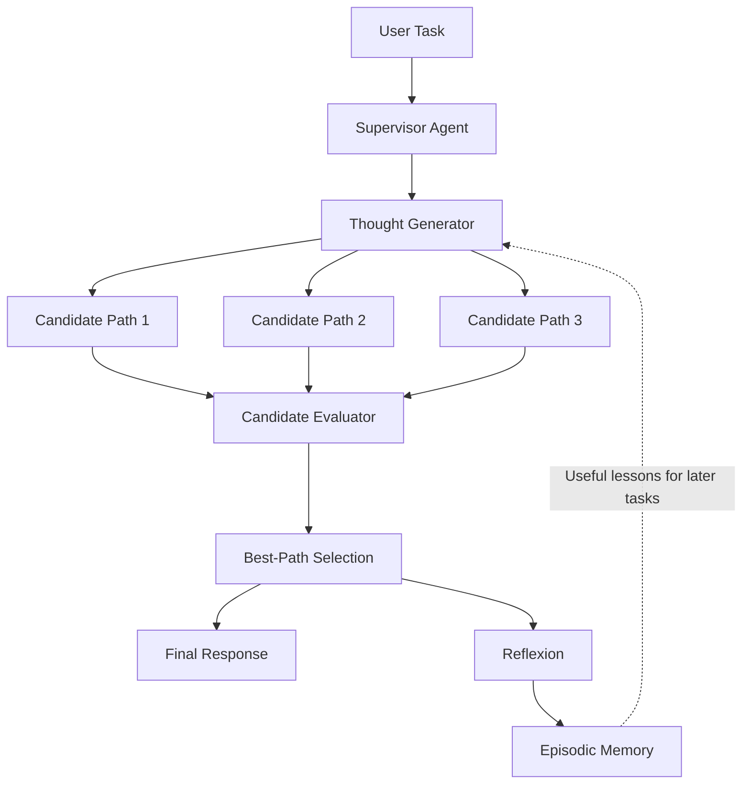
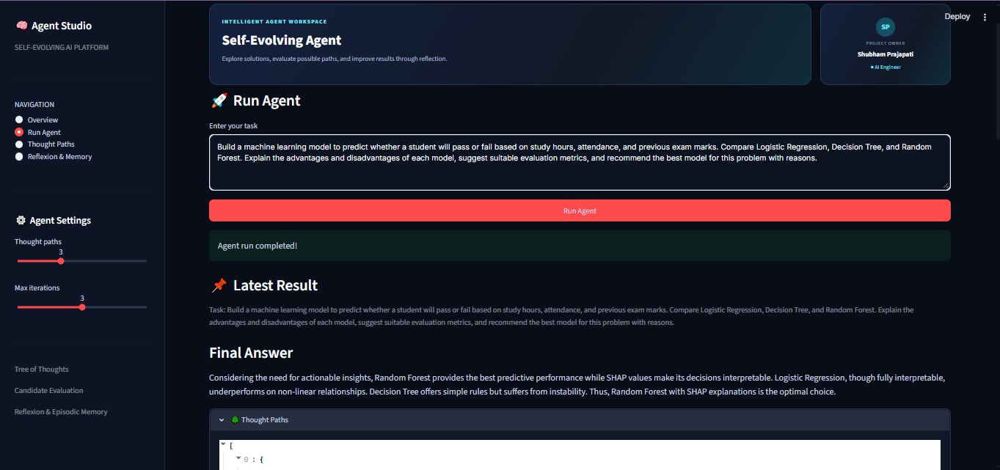

<p align="center">
  
  
  
  
</p>

<h1 align="center">🧠 Self-Evolving Agent</h1>

<h3 align="center">Tree of Thoughts · Candidate Evaluation · Reflexion · Episodic Memory</h3>

<p align="center"><em>An experimental agentic AI application that explores multiple solution approaches, evaluates candidates, reflects on outcomes, and uses stored lessons to guide future responses.</em></p>

<p align="center"><strong>Created by Shubham Prajapati · AI Engineer</strong></p>

<p align="center">
  

</p>

---

## 🌟 Overview

**Self-Evolving Agent** is an experimental Agentic AI project built to go beyond a single prompt-and-response interaction. Given a task, the agent can generate candidate approaches, evaluate them, select a promising result, and use reflection or memory components where supported by the current implementation.


### Core loop

**Generate → Evaluate → Select → Reflect → Remember → Improve**

The project explores these concepts:

- 🌳 **Tree of Thoughts:** generate more than one candidate approach.
- 📊 **Candidate Evaluation:** assess candidate quality against task requirements.
- 🏆 **Best-Path Selection:** choose a strong candidate based on evaluation results.
- 🔄 **Reflexion:** identify strengths, gaps, and possible improvements.
- 🧠 **Episodic Memory:** retain useful lessons when memory storage is configured.
- 🤖 **Supervisor Orchestration:** coordinate the agent workflow.
- ⚡ **Groq LLM Inference:** connect to a supported Groq model.
- 🖥️ **Streamlit Dashboard:** interact with the agent through a web UI.

> **Note:** The exact behavior depends on the modules and configuration present in your local project. The README describes the intended workflow; only claim persistent learning or a feature as complete if it is implemented and tested in your current codebase.

---

## 🏗️ Architecture



## 🔄 Workflow

1. **Enter a task** in the Streamlit dashboard.
2. **Generate candidates** using the thought-generation component.
3. **Evaluate candidate paths** using the evaluation logic available in the project.
4. **Select a candidate** to help produce the final response.
5. **Reflect on the result** to identify strengths or possible improvements.
6. **Store and reuse lessons** if episodic-memory persistence and retrieval are enabled.

## ✨ Features

| Feature | Purpose |
|---|---|
| 🌳 Thought Paths | Explore different approaches to the same task |
| 📊 Candidate Evaluation | Compare candidate quality |
| 🏆 Path Selection | Select a promising candidate |
| 🔄 Reflexion | Capture feedback and improvement opportunities |
| 🧠 Episodic Memory | Reuse stored lessons when implemented/configured |
| ⚙️ Agent Settings | Adjust the number of thought paths and iteration limits |
| 🖥️ Streamlit UI | Run tasks and inspect available results |
| ⚡ Groq Integration | Generate responses with a configured Groq model |

## 🛠️ Tech Stack

| Technology | Use |
|---|---|
| Python 3.11+ | Core application |
| Streamlit | Interactive dashboard |
| Groq API | LLM inference |
| LangChain Groq integration | Python interface to supported Groq chat models, if used by the current environment |
| python-dotenv | Load environment variables from `.env` |
| Agent modules | Thought generation, supervision, evaluation, selection, and reflection as implemented in the project |

If your current implementation uses LangGraph or another orchestration framework, list its exact version and role here after confirming it in `requirements.txt` and the source code.

## 📂 Project Structure

A typical layout for this project may look like this; adjust it to match the files in your repository:

```text
self-evolving-agent/
├── src/
│   ├── agents/
│   │   ├── supervisor.py
│   │   ├── thought_generator.py
│   │   ├── evaluator.py          
│   │   ├── selector.py           
│   │   └── reflexion.py          
│   ├── memory/
│   │   └── episodic_memory.py    
│   ├── graph/
│   │   └── workflow.py          
│   ├── state.py
│   └── app.py
├── images/
│   └── dashboard.png
├── requirements.txt
├── .env.example
├── .gitignore
└── README.md
```

## 🚀 Getting Started

### 1. Get the project

If this is already your local project, open a terminal in the project root. If you have pushed it to your own GitHub repository, clone it using your repository URL:

```bash
git clone https://github.com/prajapatishubham336/self-evolving-agent.git
cd self-evolving-agent
```

Replace the placeholder with your actual repository URL; do not use another person's repository URL unless it is the intended source.

### 2. Create and activate a Conda environment

```bash
conda create -n self-evolve python=3.11 -y
conda activate self-evolve
```

If you already use an environment named `llmapp`, activate that environment instead:

```bash
conda activate llmapp
```

### 3. Install dependencies

```bash
python -m pip install -r requirements.txt
```

### 4. Configure the API key

Create a `.env` file in the project root:

```env
GROQ_API_KEY=your_groq_api_key_here
```

Use a model ID currently supported by your Groq account and the installed `langchain-groq` package. If your code reads a model name from an environment variable, add the matching variable (for example, `GROQ_MODEL`) with the exact name expected by your code.

**Security:** Never commit your real API key. Add `.env` to `.gitignore` and commit only a safe `.env.example` file.

Example `.gitignore` entries:

```gitignore
.env
__pycache__/
*.py[cod]
.venv/
```

### 5. Start the dashboard

Run the command from the project root:

```bash
python -m streamlit run src/app.py
```

Streamlit normally prints a local URL such as `http://localhost:8501` in the terminal. Open that URL in your browser.

## 🖥️ Using the Dashboard

1. Open **Overview**.
2. Enter a question or task in the input area.
3. Adjust thought-path and iteration settings if needed.
4. Select **Run Agent**.
5. Review the final response and any thought paths, candidate scores, reflexion notes, or memory details that your current implementation returns.



### Example test task

```text
Build a machine learning model to predict whether a student will pass or fail
using study hours, attendance, and previous exam marks. Compare Logistic
Regression, Decision Tree, and Random Forest. Explain their trade-offs,
suggest evaluation metrics, and recommend a model with reasons.
```

A useful result should explain the trade-offs and give a reasoned recommendation rather than simply naming a model. Actual output depends on the configured model and implemented agent workflow.

## 🧠 Core Concepts

### Tree of Thoughts

Instead of relying on one initial approach, generate multiple candidate approaches to the same task. For example, one candidate might give a direct explanation, another might compare alternatives, and another might focus on a practical implementation.

### Candidate Evaluation

Candidates can be assessed against criteria such as relevance, coherence, completeness, and factual support. If the project uses numeric scores, document the actual scoring scale and formula implemented in the evaluator rather than assuming all criteria are summed equally.

### Best-Path Selection

The selection component uses the available evaluation output to choose a candidate or guide the final response. Selection quality depends on the evaluator and the quality of the generated candidates.

### Reflexion

Reflexion captures what went well, what was missing, and what could be improved. Reflection is feedback for the workflow; by itself, it does not update or train the underlying LLM weights.

### Episodic Memory

A memory component can save useful lessons from prior tasks and retrieve them later. Whether this memory persists after restarting the application depends on the storage implementation used in the project.

## ⚠️ Troubleshooting

### Groq API or model error

- Confirm `GROQ_API_KEY` is set correctly in `.env`.
- Check that the model ID is currently supported by Groq and available to your account.
- Check the installed `langchain-groq` version and the model parameter expected by your code.
- Reduce the number of thought paths or iterations if the workflow makes too many LLM calls.
- For rate-limit errors, wait for the limit window to reset and consider retry logic with backoff.

### Python package or import errors

Use the same Python environment to install packages and run Streamlit:

```bash
conda activate llmapp
python -c "import sys; print(sys.executable)"
python -m pip check
python -m streamlit run src/app.py
```

Prefer `python -m streamlit` over a standalone `streamlit` command when multiple Python environments are installed.

### Agent state or constructor errors

Check `src/state.py` and `src/agents/supervisor.py` to confirm the state format expected by `SupervisorAgent.run()`. Do not assume that a dictionary and a custom state class are interchangeable; keep the caller and supervisor interface consistent.

## 🔮 Possible Future Improvements

- [ ] Persistent memory with a database or vector store
- [ ] Structured evaluation reports and score visualization
- [ ] Retry handling and rate-limit backoff
- [ ] Unit and integration tests for agent components
- [ ] Exportable run history
- [ ] FastAPI service layer
- [ ] Docker packaging and deployment workflow
- [ ] CI checks and automated testing
- [ ] Human feedback for candidate evaluation

These are potential improvements, not claims that the features are already implemented.

## 🤝 Contributing

1. Create a feature branch.
2. Make a focused change and test it locally.
3. Commit your work with a clear message.
4. Open a pull request in your repository.

```bash
git checkout -b feature/your-feature
git add .
git commit -m "Describe your change"
git push origin feature/your-feature
```

## 📜 License

Add a `LICENSE` file and name the license here once you have chosen one. Do not claim an MIT license unless the repository actually includes that license.

## 👨‍💻 Author

**Shubham Prajapati**  
*AI Engineer · Agentic AI · Machine Learning*

- GitHub: @prajapatishubham336

---

<p align="center"><strong>🧠 Building AI systems that generate, evaluate, reflect, remember, and improve their workflow.</strong></p>
<p align="center"><em>“An AI that learns how to learn.”</em> 🚀</p>
